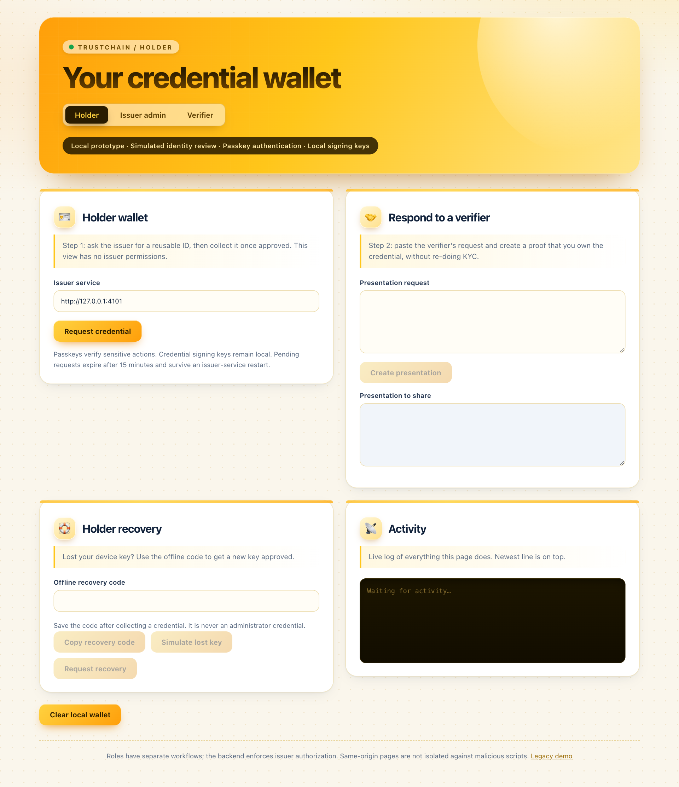
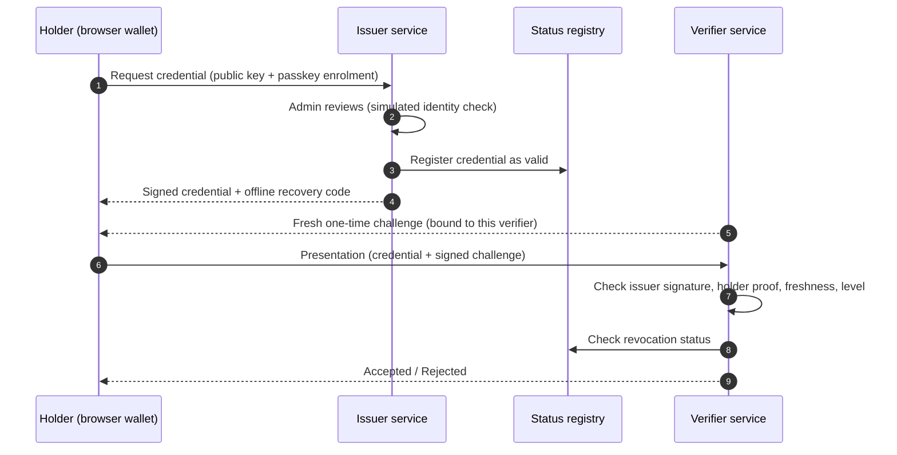
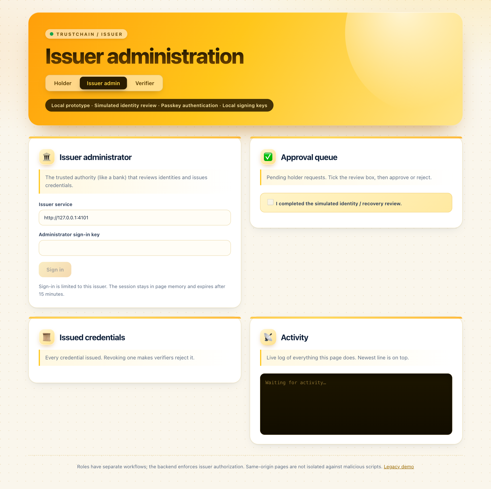
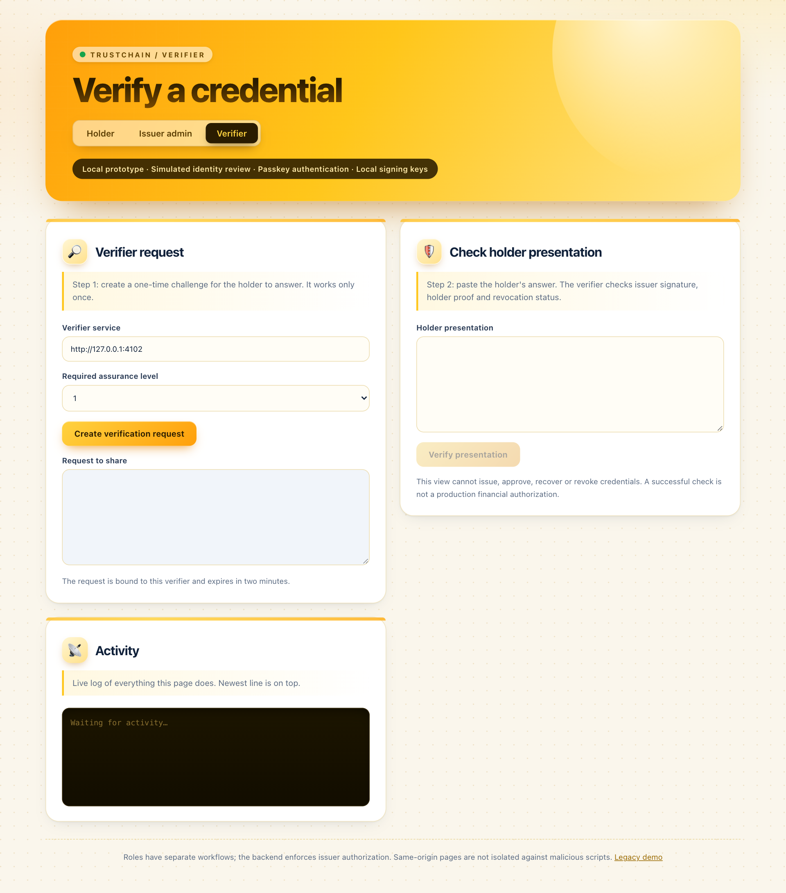

<div align="center">

# TrustChain

### Reusable identity credentials under failure

**Verify once. Reuse everywhere. Stay safe when systems fail.**




</div>

---

## The problem

Every bank and fintech repeats KYC. Users upload the same documents again and again, it is slow and costly, and many companies end up storing copies of personal data.

## The idea

Check a person **once**. The issuer gives them a signed digital credential that they keep in their **own wallet** and reuse with any verifier, without repeating KYC.

TrustChain is a working prototype of that idea, and a measured study of what happens **when parts of the system fail**: stale revocation status, issuer crashes, ambiguous blockchain broadcasts, and replayed proofs.

## How it works



| Role | Job | Where it runs |
|---|---|---|
| **Issuer** | Reviews requests, signs credentials, revokes | Service on port 4101 |
| **Holder** | Owns the credential and signing key | In the browser (WebCrypto + passkey) |
| **Verifier** | Issues challenges, checks presentations | Service on port 4102 |
| **Status registry** | Records valid or revoked status | Local Hardhat chain on port 8545 |

## Features

- **Holder-bound credentials.** The credential carries the holder's public key, signed with P-256. A copied credential is useless without the private key.
- **Passkey protection.** Touch ID or another passkey authorizes sensitive actions through a short-lived (60 s), issuer-mediated authorization.
- **Replay protection.** Challenges are random, single-use, expiring (2 minutes) and bound to one verifier.
- **Revocation.** Revoked credentials are rejected even though their signatures remain valid.
- **Three status backends**, compared in the study: signed per-credential status, a signed aggregate status list (131,072-bit bitstring, cacheable), and a smart-contract registry on a local chain.
- **Key rotation and recovery.** Rotation needs the old and new keys plus a passkey check. Recovery needs an offline code plus issuer approval. The old credential is revoked before the new one is registered.
- **Crash-safe issuer.** Signed chain transactions are saved to an encrypted SQLite journal (a durable outbox) before they are sent, so the issuer can recover after a crash, or block safely when a broadcast is ambiguous.
- **Separate role dashboards** for holder, issuer administrator and verifier.

<table>
<tr>
<td></td>
<td></td>
</tr>
<tr>
<td align="center"><sub>Issuer administration</sub></td>
<td align="center"><sub>Verifier</sub></td>
</tr>
</table>

## Results

| Experiment | Finding |
|---|---|
| **Status-check ablation** (4,320 attempts, 75 ms added delay) | Cached signed list **320.9 ms**, signed per-credential status 475.9 ms, chain registry 477.3 ms |
| **Protected presentations** (360 runs) | Roughly 35 to 51 ms per presentation across the three backends |
| **Fault matrix** (27 trials) | 21 recovered automatically, 6 blocked safely, none silently wrong |
| **Privacy trace** | Issuer-visible audiences and cross-verifier linkability remain, and are documented as limits |

Caching is fastest but can be briefly stale, so the study gives a tolerance bound for how stale a verifier may be. The chain registry matched the non-blockchain signed status, so it is a trade-off, not a requirement. Full methodology and raw detail are in [`research/reusable-kyc/`](research/reusable-kyc/).

## Quick start

**Requirements:** Node.js 22 (the tested runtime), npm, and a Chromium-based browser. Passkeys work on `localhost`.

```bash
# 1. Install dependencies
npm install
(cd hardhat && npm install)

# 2. Start a disposable local chain (terminal 1)
cd hardhat
node node_modules/hardhat/internal/cli/cli.js \
  --config ../research/reusable-kyc/local-chain.cjs \
  node --hostname 127.0.0.1 --port 8545
```

In a second terminal, from the project root:

```bash
# 3. Create a fresh demo identity and deploy the status contract
node research/reusable-kyc/setup-chain-local.mjs .trustchain-demo

# 4. Start the issuer, the verifier and the web app (one terminal each)
node research/reusable-kyc/service.mjs .trustchain-demo/issuer.json
node research/reusable-kyc/service.mjs .trustchain-demo/verifier.json
npm run dev -- --host localhost
```

Open three browser windows:

| Role | URL |
|---|---|
| Holder | http://localhost:5173/?role=holder |
| Issuer admin | http://localhost:5173/?role=issuer |
| Verifier | http://localhost:5173/?role=verifier |

The issuer administrator key is the `adminToken` value in `.trustchain-demo/issuer.json`. It is generated for each setup and never committed.

> Restarting the chain discards its state. Create a new demo directory afterwards instead of reusing an old one.

## Demo walkthrough

1. **Holder:** click *Request credential* and approve the passkey prompt.
2. **Issuer:** sign in with the admin key, click *Refresh requests*, tick the simulated review box, then *Approve request*.
3. **Holder:** click *Check approval* to collect the credential and the offline recovery code.
4. **Verifier:** click *Create verification request* and copy it (valid for two minutes).
5. **Holder:** paste it into *Presentation request*, click *Create presentation*, and copy the result.
6. **Verifier:** paste it into *Holder presentation* and click *Verify presentation*. Expect **Accepted**.
7. **Replay test:** verify the same text again. Expect **Failed: Missing, consumed or expired challenge**.
8. **Revocation:** revoke the credential in the issuer window and run steps 4 to 6 again. Expect a rejection.

Keep the verifier's assurance level on **1**. The prototype issues level 1 credentials, so levels 2 and 3 are rejected by design.

## Tests

```bash
# 66 unit and integration tests (protocol, status lists, passkeys, storage, recovery, ...)
node --test research/reusable-kyc/*.test.mjs
```

An automated end-to-end browser test drives the full flow with a virtual passkey authenticator. See [`research/reusable-kyc/DURABLE-DEMO.md`](research/reusable-kyc/DURABLE-DEMO.md) for how to run it.

## Project structure

```text
.
├── src/                       React dashboards (holder, issuer, verifier) and browser crypto client
├── research/reusable-kyc/     Protocol, services, status backends, outbox, tests, experiments and notes
│   ├── protocol.mjs           Credentials, proofs, challenges, verification
│   ├── service.mjs            Issuer and verifier HTTP services
│   ├── status-list.mjs        Signed aggregate status list
│   ├── chain.mjs              Chain registry client and durable transaction outbox
│   ├── CredentialStatus.sol   Status registry smart contract
│   └── *.test.mjs             Unit and integration tests
├── hardhat/                   Local chain tooling and the original registry contract
├── server/                    Legacy WebAuthn demo server
└── docs/                      Study guide, demo script and screenshots
```

## Documentation

| Document | What it covers |
|---|---|
| [`docs/STUDY_GUIDE.md`](docs/STUDY_GUIDE.md) | Every concept in plain language, with a question bank |
| [`docs/TrustChain_Demo_Script.docx`](docs/TrustChain_Demo_Script.docx) | Editable two-speaker demo script |
| [`research/reusable-kyc/SERVICES.md`](research/reusable-kyc/SERVICES.md) | Setup, protocol details and measurement definitions |
| [`research/reusable-kyc/TRUST_MODEL.md`](research/reusable-kyc/TRUST_MODEL.md) | Trust, privacy and recovery assumptions |
| [`research/reusable-kyc/THREAT-MODEL.md`](research/reusable-kyc/THREAT-MODEL.md) | Who can see and do what |
| [`research/reusable-kyc/OUTBOX.md`](research/reusable-kyc/OUTBOX.md) | Durable transaction outbox and crash recovery |
| [`research/reusable-kyc/STATUS-FRESHNESS.md`](research/reusable-kyc/STATUS-FRESHNESS.md) | Cache lifetime and staleness bounds |
| [`research/reusable-kyc/PASSKEYS.md`](research/reusable-kyc/PASSKEYS.md) | Passkey authorization design |
| [`docs/LEGACY_APP.md`](docs/LEGACY_APP.md) | README of the earlier demo, kept for reference |

## Security notes and limits

This is a **research prototype at TRL 4** (validated in a laboratory), not a production system.

- Identity review is **simulated** with an approval checkbox. A real issuer would verify documents, match a live face and screen against watchlists.
- The blockchain is a **local, disposable test chain**. The deployer key used by the setup script is a public Hardhat test key. Never use it for real assets.
- The credential format is **custom**, signed with P-256. It is not the W3C Verifiable Credentials standard, and interoperability is not claimed.
- Holder keys are non-exportable WebCrypto keys, which is an API property and not hardware attestation. Same-origin scripts are not isolated from a malicious page.
- Privacy is reduced, not eliminated: the issuer sees which audiences are involved in the passkey step, and verifiers can link repeated use of one credential.
- Verifiers must already know which issuers to trust. A real deployment needs a trusted-issuer list.
- Automated tests use a virtual passkey authenticator. They show the integration works, not real biometric behaviour.
- Use synthetic identities only.

Never commit `.env`, anything in `.trustchain-*` folders, or any `transaction.key` file. They are listed in `.gitignore`.

## Team

- **Manav M Bahuguna**
- **Navya Gupta**
- **Faculty mentor:** Dr Rajalakshmi
- **FinTech vertical** · SRM Institute of Science and Technology

## Status

Research prototype. Contributions and issues are welcome, but please do not use this to handle real identity data.
